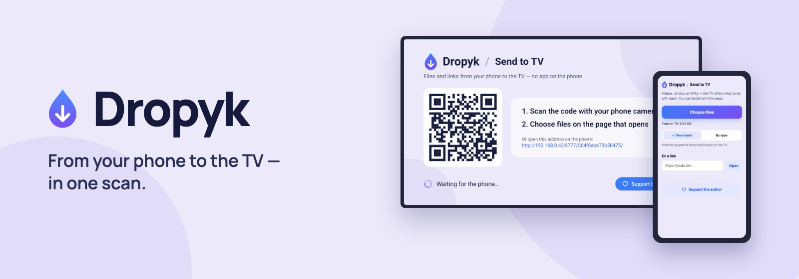
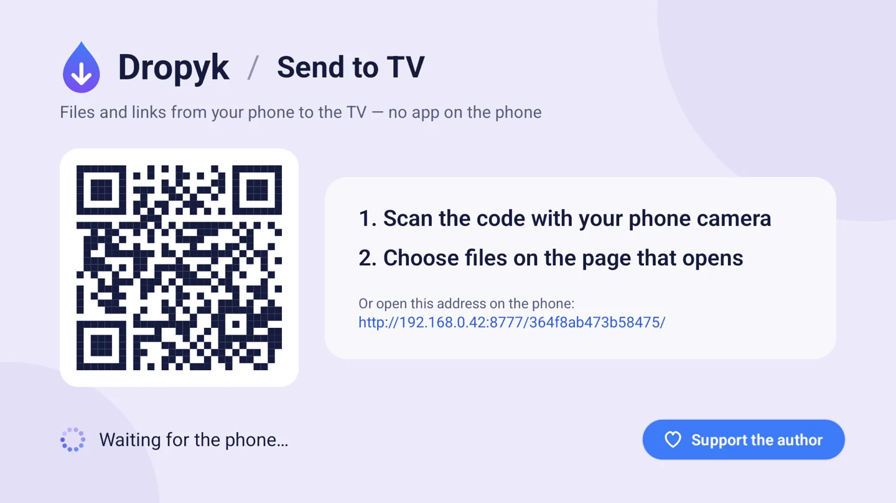
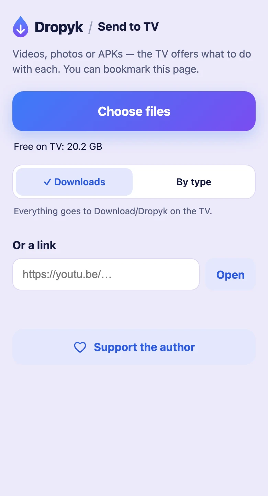
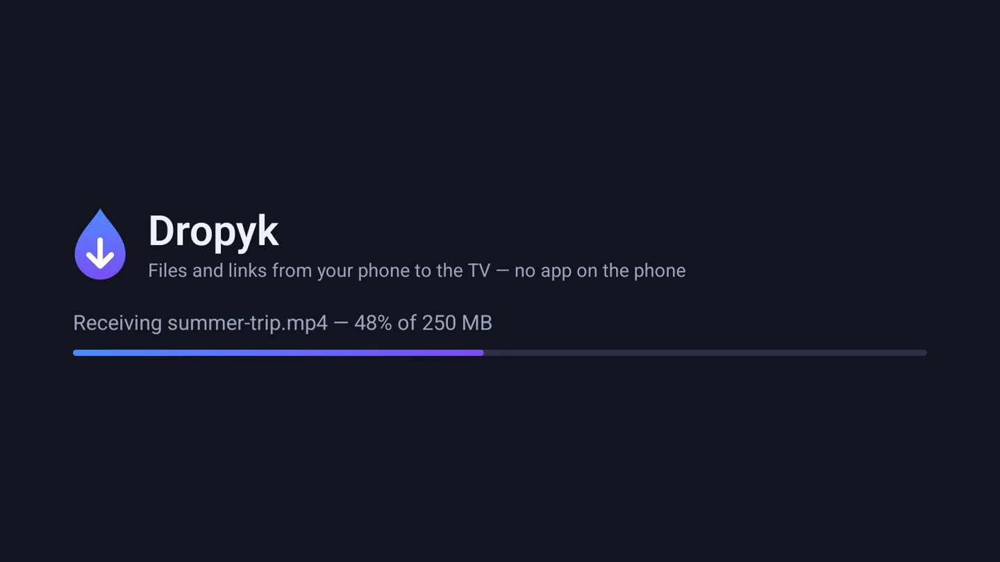
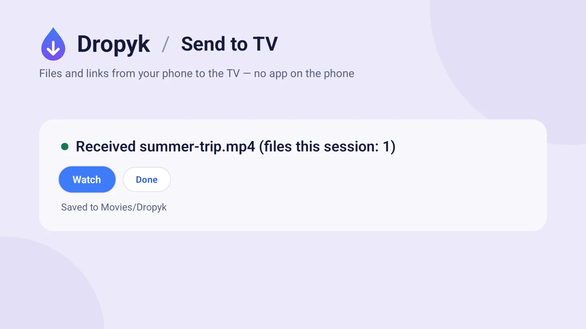
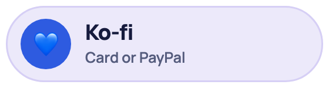
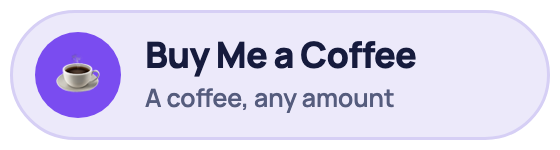
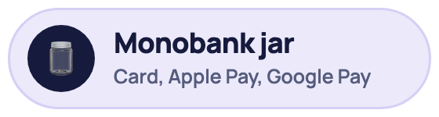

**English** · [Українська](README.uk.md)

Send files and links from your phone to an Android TV or Google TV over your home network: from any phone through a QR code and the browser, or from an Android phone through Quick Share. No phone app, no account, no cloud.

**[Download APK](https://github.com/Syvyj/dropyk-android/releases/latest/download/dropyk.apk)** · **[Website](https://dropyk.syvyj.dev/)** · **[Installation](#installation)**

`Android TV / Google TV` `Android 7.0+` `~1 MB` `GPL-3.0`

For receiving on a Mac from an Android phone, see [Dropyk for Mac](https://github.com/Syvyj/dropyk-mac).

## How it works

1. **Open** Dropyk on the TV. It shows a QR code.
2. **Scan** the code with the phone's camera. A page served by the TV itself opens; you can bookmark it.
3. **Send** — choose files or paste a link or text, and they appear on the TV.

From an Android phone it's shorter: with Dropyk open on the TV, **Share → Quick Share** and pick the TV. The TV asks to accept and shows the PIN the phone shows.

## Features

- **Photos, videos, APKs, any file** — one or a hundred at a time, sent one by one. Bytes go straight to the TV's storage, so a 4 GB film never passes through its memory; the page checks free space first. On a budget Google TV box over Wi‑Fi, files arrive at about 12–20 MB/s.
- **Quick Share** — the TV shows up in the Share sheet of Android phones on the same Wi‑Fi, under its own name. Files, links and text; the TV asks before accepting.
- **iPhone, iPad and Mac** — add the [Send to Dropyk](https://dropyk.syvyj.dev/shortcut/Send%20to%20Dropyk.shortcut) shortcut, type the TV's address once (it's under the QR code), and Dropyk shows up in the Share sheet for photos, videos and files.
- **Links and text** — paste a link to open it on the TV, or any text (a Wi‑Fi password, a code) to show it big on the screen.
- **Cancel any time** — *Stop sending* on the phone or *Cancel* on the TV; the half-received file is removed.
- **From a computer too** — open the address under the QR code in any browser and drop files onto the page.
- **One press with the remote** — a video plays, an APK installs, a photo shows on screen, a link opens.
- **You choose where files go** — *Downloads* puts everything in `Download/Dropyk`; *By type* puts videos in `Movies/Dropyk`, photos in `Pictures/Dropyk`, music in `Music/Dropyk` and the rest in `Download/Dropyk`. The phone remembers the choice.
- **Receive in background** — a switch on the main screen keeps Dropyk receiving while it's closed, starts it after a reboot, and brings it to the screen when something arrives (it asks for *Display over other apps* for that).
- **Dark or light** — dark by default, like the TV around it; one button switches. The phone page and the site follow the phone's theme.
- **Updates itself** — every 6 hours it checks GitHub and offers *Update to …* on the TV.
- **English and Ukrainian** on the TV and on the phone page.

| TV | Phone |
|:---:|:---:|
|  |  |
|  |  |

## Installation

1. Download [`dropyk.apk`](https://github.com/Syvyj/dropyk-android/releases/latest/download/dropyk.apk).
2. Copy it to the TV: the Downloader app, a USB stick, or `adb install dropyk.apk`.
3. Allow installing from that source when the TV asks, then open Dropyk from the app list.

No storage permission is needed on Android 10+. On Android 7–9 files go to the app's own folder.

## Support the author

Dropyk is free and will stay free. If it saves you time, you can buy me a coffee:

<p>
  <a href="https://ko-fi.com/syvyj"></a>
  <a href="https://buymeacoffee.com/syvyj"></a>
  <a href="https://send.monobank.ua/jar/5juJPj142b"></a>
</p>

## Privacy

- Files go from the phone to the TV over your own network. There is no server in between and nothing is uploaded anywhere.
- The page address carries a secret key, so only someone who saw the code can send. *New address* on the TV changes it (bookmarks and the iPhone shortcut then need the new one).
- Quick Share is encrypted end to end (the same UKEY2 key exchange phones use), and the TV asks before every transfer.
- The TV listens only while Dropyk is open or *Receive in background* is on. No account, no ads, no tracking.


## Building

```
./gradlew :app:assembleRelease
```

Release signing reads `DROPYK_KEYSTORE`, `DROPYK_KEYSTORE_PASSWORD`, `DROPYK_KEY_ALIAS` and `DROPYK_KEY_PASSWORD` from `.env` or `-P`; without them the release build stays unsigned (`app-release-unsigned.apk`), so an APK that wouldn't install over the real one can't be published by mistake.

The iPhone shortcut comes from [`shortcut/make.py`](shortcut/make.py) (macOS: it signs with `shortcuts sign`).

The site lives in [`web/`](web/): `python3 web/build.py` writes the English and Ukrainian pages. The README banners and social previews come from [`docs/banner.html`](docs/banner.html): `docs/render-banners.sh` (needs Google Chrome).

## License

[GPL-3.0](LICENSE).

The Quick Share receiver is a Kotlin port of the receiving side of [NearDrop](https://github.com/grishka/NearDrop) by Grishka (Unlicense), who reverse engineered the protocol. The `.proto` files in `app/src/main/proto` are © Google LLC, Apache-2.0.
