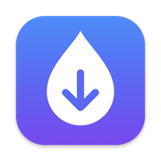

<div align="center">

[English](README.md) · **Українська**



# Dropyk

**З телефона на телевізор одним скануванням.**

Відкрийте Dropyk на Android TV чи Google TV, наведіть камеру телефона на код і виберіть файли.
Відео, фото, APK та посилання йдуть просто через домашній Wi‑Fi — без застосунку на телефоні, без хмари й акаунта.

### [Завантажити APK](https://github.com/Syvyj/dropyk-android/releases/latest/download/dropyk.apk) · [dropyk.syvyj.dev/uk](https://dropyk.syvyj.dev/uk/)

`Android TV / Google TV` · `Android 7.0+` · `~1 МБ` · `GPL-3.0`

 

</div>

## Як це працює

1. **Скануйте.** Dropyk піднімає на телевізорі невеликий вебсервер. QR-код веде телефон на сторінку, яку віддає сам телевізор. Адреса стала, тож закладка й далі працюватиме.
2. **Надішліть.** Виберіть один файл чи сотню. Вони йдуть по черзі, одразу на диск телевізора, тож фільм на 4 ГБ не проходить через його пам'ять. Посилання теж можна.
3. **Натисніть OK.** Телевізор сам пропонує, що робити: відео — дивитись, APK — встановити, фото — показати, посилання — відкрити.

На недорогій приставці з Google TV через Wi‑Fi файли приходять зі швидкістю приблизно 12–20 МБ/с.

## Куди лягають файли

Обираєте на сторінці телефона, і телефон це запам'ятовує:

- **У завантаження** — усе в `Download/Dropyk`.
- **За типом** — відео в `Movies/Dropyk`, фото в `Pictures/Dropyk`, музика в `Music/Dropyk`, решта в `Download/Dropyk`.

На Android 10+ дозвіл на доступ до пам'яті не потрібен. На Android 7–9 файли лягають у власну теку застосунку.

## Приватність

- Файли йдуть з телефона на телевізор вашою власною мережею. Жодного сервера посередині, нічого нікуди не вивантажується.
- В адресі сторінки є секретний ключ, тож надіслати може лише той, хто бачив код.
- Телевізор приймає, лише поки відкритий Dropyk. Без акаунта, реклами й стеження.

## Встановлення

1. Завантажте [`dropyk.apk`](https://github.com/Syvyj/dropyk-android/releases/latest/download/dropyk.apk).
2. Перенесіть на телевізор: застосунком Downloader, флешкою або командою `adb install dropyk.apk`.
3. Коли телевізор попросить, дозвольте встановлення з цього джерела, потім відкрийте Dropyk зі списку застосунків.

## Далі

- Телевізор у меню **Quick Share** на Android-телефонах.
- Надсилання з Mac через **Dropyk для Mac**.
- **Ярлик для iPhone** у меню «Поділитися».

## Збірка

```
./gradlew :app:assembleRelease
```

Підпис release-збірки бере `DROPYK_KEYSTORE`, `DROPYK_KEYSTORE_PASSWORD`, `DROPYK_KEY_ALIAS` і `DROPYK_KEY_PASSWORD` з `.env` або `-P`; без них release-збірка підписується debug-ключем.

Сайт лежить у [`web/`](web/): `python3 web/build.py` збирає англійську й українську сторінки.

## Підтримати

Dropyk безкоштовний і таким лишиться. [Банка Monobank](https://send.monobank.ua/jar/5juJPj142b) · [Ko-fi](https://ko-fi.com/syvyj) · [Buy Me a Coffee](https://buymeacoffee.com/syvyj)

## Ліцензія

[GPL-3.0](LICENSE).
