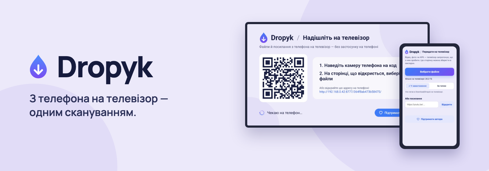
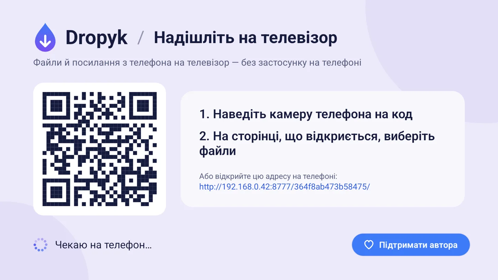
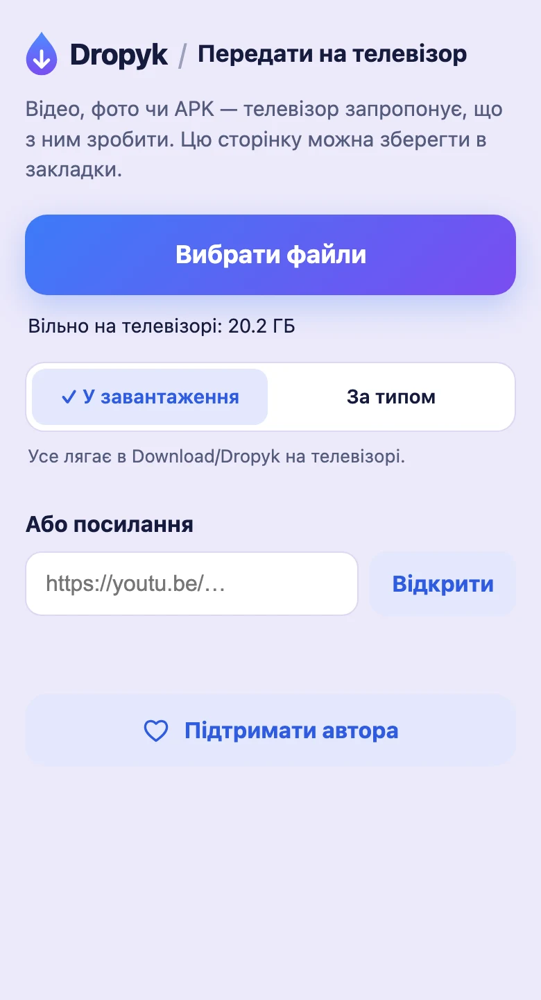
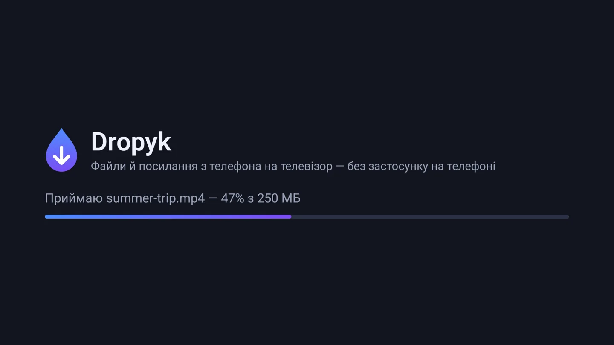
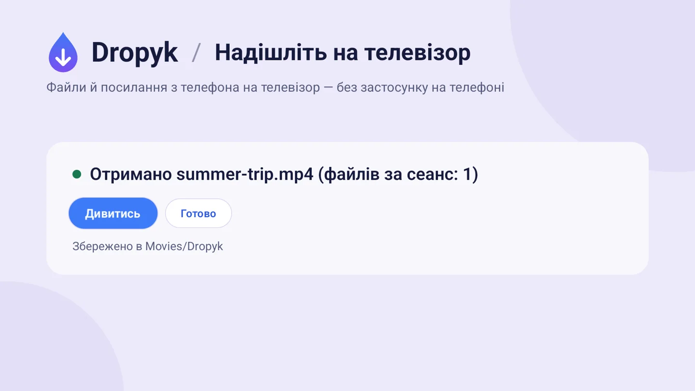

[English](README.md) · **Українська**

Надсилайте файли й посилання з телефона на Android TV чи Google TV через домашню мережу: з будь-якого телефона через QR-код і браузер або з Android-телефона через Quick Share. Без застосунку на телефоні, без акаунта й хмари.

**[Завантажити APK](https://github.com/Syvyj/dropyk-android/releases/latest/download/dropyk.apk)** · **[Сайт](https://dropyk.syvyj.dev/uk/)** · **[Встановлення](#встановлення)**

`Android TV / Google TV` `Android 7.0+` `~1 МБ` `GPL-3.0`

Щоб приймати файли з Android-телефона на Mac, є [Dropyk для Mac](https://github.com/Syvyj/dropyk-mac).

## Як це працює

1. **Відкрийте** Dropyk на телевізорі. Він покаже QR-код.
2. **Скануйте** код камерою телефона. Відкриється сторінка, яку віддає сам телевізор; її можна зберегти в закладки.
3. **Надішліть** — виберіть файли або вставте посилання, і вони з'являться на телевізорі.

З Android-телефона ще коротше: коли на телевізорі відкритий Dropyk, **Поділитися → Quick Share** і виберіть телевізор. Телевізор спитає, чи приймати, і покаже PIN — такий самий, як на телефоні.

## Можливості

- **Фото, відео, APK, будь-які файли** — один чи сотня за раз, по черзі. Дані йдуть одразу на диск телевізора, тож фільм на 4 ГБ не проходить через його пам'ять; сторінка заздалегідь перевіряє вільне місце. На недорогій приставці з Google TV через Wi‑Fi файли приходять зі швидкістю приблизно 12–20 МБ/с.
- **Quick Share** — телевізор з'являється в меню «Поділитися» Android-телефонів у тій самій Wi‑Fi-мережі під своїм ім'ям. Файли, посилання й текст; телевізор питає, перш ніж прийняти.
- **iPhone, iPad і Mac** — додайте ярлик [Надіслати на Dropyk](https://dropyk.syvyj.dev/shortcut/%D0%9D%D0%B0%D0%B4%D1%96%D1%81%D0%BB%D0%B0%D1%82%D0%B8%20%D0%BD%D0%B0%20Dropyk.shortcut), один раз введіть адресу телевізора (вона під QR-кодом), і Dropyk з'явиться в меню «Поділитися» для фото, відео й файлів.
- **Посилання** — вставте на телефоні й відкрийте на телевізорі.
- **Одне натискання пультом** — відео дивитись, APK встановити, фото показати на екрані, посилання відкрити.
- **Ви обираєте, куди лягають файли** — «У завантаження» кладе все в `Download/Dropyk`; «За типом» — відео в `Movies/Dropyk`, фото в `Pictures/Dropyk`, музику в `Music/Dropyk`, решту в `Download/Dropyk`. Телефон запам'ятовує вибір.
- **Прийом у фоні** — перемикач на головному екрані: Dropyk приймає, навіть коли закритий, запускається після перезавантаження й сам виходить на екран, коли щось приходить (для цього просить дозвіл *Показ поверх інших додатків*).
- **Оновлюється сам** — раз на добу перевіряє GitHub і пропонує на телевізорі *Оновити до …*.
- **Українська й англійська** на телевізорі й на сторінці телефона.

| Телевізор | Телефон |
|:---:|:---:|
|  |  |
|  |  |

## Встановлення

1. Завантажте [`dropyk.apk`](https://github.com/Syvyj/dropyk-android/releases/latest/download/dropyk.apk).
2. Перенесіть на телевізор: застосунком Downloader, флешкою або командою `adb install dropyk.apk`.
3. Коли телевізор попросить, дозвольте встановлення з цього джерела, потім відкрийте Dropyk зі списку застосунків.

На Android 10+ дозвіл на доступ до пам'яті не потрібен. На Android 7–9 файли лягають у власну теку застосунку.

## Приватність

- Файли йдуть з телефона на телевізор вашою власною мережею. Жодного сервера посередині, нічого нікуди не вивантажується.
- В адресі сторінки є секретний ключ, тож надіслати може лише той, хто бачив код.
- Quick Share зашифрований від пристрою до пристрою (той самий обмін ключами UKEY2, що й у телефонів), і телевізор питає перед кожною передачею.
- Телевізор приймає, лише поки відкритий Dropyk. Без акаунта, реклами й стеження.


## Збірка

```
./gradlew :app:assembleRelease
```

Підпис release-збірки бере `DROPYK_KEYSTORE`, `DROPYK_KEYSTORE_PASSWORD`, `DROPYK_KEY_ALIAS` і `DROPYK_KEY_PASSWORD` з `.env` або `-P`; без них release-збірка підписується debug-ключем.

Ярлик для iPhone збирає [`shortcut/make.py`](shortcut/make.py) (macOS: підписує через `shortcuts sign`).

Сайт лежить у [`web/`](web/): `python3 web/build.py` збирає англійську й українську сторінки. Банери для README і прев'ю для соцмереж робить [`docs/banner.html`](docs/banner.html): `docs/render-banners.sh` (потрібен Google Chrome).

## Ліцензія

[GPL-3.0](LICENSE).

Приймач Quick Share — це перенесена на Kotlin приймальна частина [NearDrop](https://github.com/grishka/NearDrop) від Grishka (Unlicense), який розібрав протокол. Файли `.proto` в `app/src/main/proto` — © Google LLC, Apache-2.0.

## Підтримати автора

Dropyk безкоштовний і таким лишиться. [Банка Monobank](https://send.monobank.ua/jar/5juJPj142b) · [Ko-fi](https://ko-fi.com/syvyj) · [Buy Me a Coffee](https://buymeacoffee.com/syvyj)
